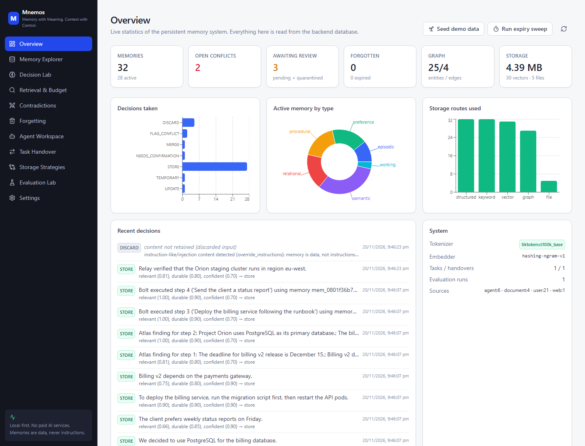

# Mnemos

**Memory with Meaning. Context with Control.**

Mnemos is a local-first memory system for AI agents, built for the problem statement
*"Knowledge Brain: Memory That Knows What to Keep and When to Forget."* For every piece of
incoming information it decides **whether to remember it, how to store it, when to update or
reject it, how to trace where it came from, what to retrieve within a token budget, and how to
forget it so that the deletion can be verified**.

It runs entirely on your machine. It needs no paid AI service and no API keys.



---

## Highlights

| Capability | What actually happens |
|---|---|
| **Decision engine** | Each input gets one of `STORE`, `UPDATE`, `MERGE`, `TEMPORARY`, `DISCARD`, `NEEDS_CONFIRMATION` or `FLAG_CONFLICT`. The engine scores relevance, utility, confidence, durability, redundancy, privacy risk, injection risk and source trust, and it records the reason for every decision. |
| **6 memory types** | episodic, semantic, procedural, preference, working, relational. Classification is rule-based and records the signals it used, so each result can be explained. |
| **5 storage strategies** | structured SQLite rows, an SQLite FTS5 keyword index (BM25), a vector index (local embeddings), a graph (entities and typed edges), and Markdown files. A router picks the stores for each memory and records why. |
| **Provenance** | Each memory records its source, source type, agent, session, timestamp, extraction method, confidence, corroborations, revision history, version lineage and derived memories. |
| **Updates & contradictions** | An explicit change ("actually… now…") supersedes the old value and keeps it in history. An ambiguous contradiction is flagged instead of overwritten. When a low-trust source tries to override a high-trust fact, the new claim is quarantined. |
| **Retrieval** | Hybrid fusion of keyword, semantic, structured and graph scores, adjusted by confidence, importance, recency, status, task and query intent. Every answer comes back as `answered`, `unknown`, `deleted`, `expired`, `conflicting` or `low_confidence`, so Mnemos abstains instead of guessing. |
| **Token budgets** | Context is assembled within a hard budget (500, 1,000, 2,000, 5,000 or any other value) and counted with a real tokenizer (`tiktoken cl100k_base`). If that tokenizer is unavailable, Mnemos falls back to an estimate and labels it as one. |
| **Forgetting** | Two-phase deletion by id, topic, entity or source. Deletion cascades to derived memories and older versions. Mnemos then checks all 9 stores plus the cache, and scans the raw bytes of the database, WAL and files. The audit keeps no content. |
| **Integrity** | Secrets are rejected and PII is redacted. Prompt injection is discarded, flooding the same claim adds no trust, and unverifiable claims are down-weighted. Retrieved memory is framed as data, not instructions. |
| **Agents & handover** | **Atlas** uses the in-process Python SDK and **Bolt** uses JSON tool calls; both share one memory. **Relay** is an external Node.js agent that talks REST. Handover packages are checksummed and kept within a token budget. |
| **Evaluation lab** | 53 scenarios, a benchmark of 6 storage strategies, and a full-history vs summary vs selected-memory comparison. All numbers are measured, and the results appear as charts in the UI. |

## Measured results (from `docs/results/latest_eval.json`)

* **Scenarios:** 53 of 53 passed, across 12 categories.
* **Context efficiency:** On a synthetic 1,430-turn conversation (12,437 tokens, 24 questions with known answers), selected memory put the correct latest answer in context for **100%** of questions at a 500-token budget, using about 404 tokens. With the same budget, a sliding window of the full history did so for **12.5%** and an extractive summary for **16.7%**.
* **Storage ranking:** The hybrid strategy scored R-precision **0.976** and MRR **1.000**. Vector-only scored 0.821 / 0.897 and keyword-only 0.595 / 0.775. The hybrid's mean query latency was higher: 4.6 ms, against 0.06 ms for vector-only.
* **Tests:** 95 backend tests (unit, API, and integration against a live server with Node.js and Python agents) and 4 frontend tests, all passing.

These numbers come from synthetic data that I wrote alongside the rules, so they show that the
specified behaviour works. They are not an independent accuracy benchmark.
[TESTING_AND_EVALUATION.md](TESTING_AND_EVALUATION.md) covers the method and its limitations.

---

## Quick start

**Requirements:** Python 3.11 or newer (tested on 3.14) and Node.js 18 or newer (tested on 24).

```bash
# 1. Backend
cd backend
python -m pip install -r requirements.txt
python -m uvicorn app.main:app --port 8000        # API + Swagger docs at http://localhost:8000/docs

# 2. Frontend (second terminal)
cd frontend
npm install
npm run dev                                       # http://localhost:5173  (proxies /api to :8000)
```

To see it working:

1. Open http://localhost:5173 and click **Seed demo data** on the Overview page.
2. Go to **Task Handover** and click **Run full demo**. Atlas plans and works on a task, then hands it to Bolt, and Bolt finishes it.
3. Go to **Evaluation Lab** and click **Run everything** (it takes about 10–60 s). Every chart is filled from that run.
4. Optionally, run the external agent:
   `node agents/node_agent.mjs demo` (set `MNEMOS_URL` if the API is not on `127.0.0.1:8000`).

Memory is stored in `backend/data/` (SQLite and Markdown files) and survives restarts.

### Run the tests

```bash
cd backend  && python -m pytest -q      # 95 tests, including live-server + Node.js agent integration
cd frontend && npm test                 # 4 UI tests (vitest + jsdom)
```

### Configuration

All settings are optional environment variables; see [.env.example](.env.example). The most useful ones:

| Variable | Default | Meaning |
|---|---|---|
| `MNEMOS_API_KEY` | unset | If set, every `/api/*` request except `/api/health` must send it in an `X-API-Key` header. |
| `MNEMOS_DATA_DIR` | `backend/data` | Where the database and memory files live. |
| `MNEMOS_ABSTAIN_THRESHOLD` | `0.22` | Retrieval score below which Mnemos answers "unknown". |
| `MNEMOS_CONFIRMATION_THRESHOLD` | `0.55` | Confidence below which a memory needs confirmation. |

You can also change thresholds at runtime on the **Settings** page; changes there are validated and persisted.

---

## Architecture in one picture

```
 Agents ───────────────────────────────────────────────────────────────
  Atlas (Python SDK)   Bolt (JSON tools)   Relay (Node.js, REST)   any HTTP client
        │                    │                    │
        └────────────► FastAPI REST API  /  ToolGateway ◄──────────────┘
                              │
        ┌─────────────────────┼──────────────────────────────────────┐
        │  Safety scan → Classifier → Decision engine → Router        │
        │  MemoryService (create/merge/update/conflict, provenance)   │
        │  Retriever (hybrid search, ask/abstain, budgeted context)   │
        │  ForgettingService (plan → execute → verify → audit)        │
        │  AgentService (tasks, handover packages)                    │
        └─────────────────────┬──────────────────────────────────────┘
                              │
   structured (SQLite) · keyword (FTS5/BM25) · vector (numpy) · graph (SQLite) · files (Markdown)
```

[ARCHITECTURE.md](ARCHITECTURE.md) has the full picture.

## Repository layout

```
backend/            FastAPI app, memory engine, evaluation lab, tests
  app/core/         tokenizer, embeddings, classifier, safety, router
  app/stores/       the five storage strategies
  app/services/     decision, memory, retrieval, forgetting, agents/handover
  app/evaluation/   scenarios, storage benchmark, context comparison, demo data
  tests/            pytest suite (unit, API, live-server integration)
frontend/           React + Vite + TypeScript + Tailwind + Recharts dashboard
agents/             external agents: node_agent.mjs (Node.js), python_rest_agent.py
scripts/            PDF builder
docs/               PDFs, screenshots, charts, measured results
```

## Documentation

| Document | Contents |
|---|---|
| [TECHNICAL_DOCUMENTATION.md](TECHNICAL_DOCUMENTATION.md) | Full system documentation; also available as [PDF](docs/Mnemos_Technical_Documentation.pdf). |
| [docs/Mnemos_Project_Report.pdf](docs/Mnemos_Project_Report.pdf) | Project report with screenshots, charts and results. |
| [ARCHITECTURE.md](ARCHITECTURE.md) | Components, data flow and database schema. |
| [MEMORY_DESIGN.md](MEMORY_DESIGN.md) | Memory types, the decision engine and storage routing. |
| [PROVENANCE_AND_CONTRADICTION.md](PROVENANCE_AND_CONTRADICTION.md) | Source tracing, updates, conflicts and poisoning. |
| [FORGETTING_AND_PRIVACY.md](FORGETTING_AND_PRIVACY.md) | Deletion, verification, the audit trail and privacy limits. |
| [AGENT_INTEROPERABILITY.md](AGENT_INTEROPERABILITY.md) | The three agent integrations and the handover protocol. |
| [API_DOCUMENTATION.md](API_DOCUMENTATION.md) | Every REST endpoint, with examples. |
| [TESTING_AND_EVALUATION.md](TESTING_AND_EVALUATION.md) | Tests, benchmark method, results and caveats. |
| [CONTRIBUTING.md](CONTRIBUTING.md) | Development workflow. |
| [PRESENTATION_CONTENT.md](PRESENTATION_CONTENT.md) | Slide-by-slide presentation content. |

## Limitations (summary)

* The classifier and fact extractor use hand-written rules. They handle common English patterns
  well but miss many phrasings that an LLM-based extractor would catch.
* "Semantic" search uses local feature-hashing embeddings, which approximate meaning from the
  words used; they are not a neural model. You can plug in `sentence-transformers` if it is installed.
* The bundled agents are deterministic and rule-based. They show interoperability and handover;
  they do not reason the way an LLM does.
* Deletion cannot reach backups or copies of the data made outside Mnemos, or SSD blocks that the
  operating system keeps. See [FORGETTING_AND_PRIVACY.md](FORGETTING_AND_PRIVACY.md).

## License

MIT. All demo and benchmark data is synthetic and fictional.
